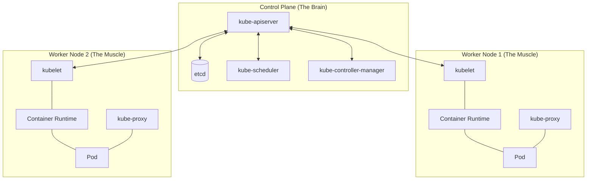

# Kubernetes Introduction

## Table of Contents

* [1. High-Level Overview](#1-high-level-overview)
* [2. What is Kubernetes?](#2-what-is-kubernetes)
* [3. Kubernetes Components](#3-kubernetes-components)
    * [3.1 Control Plane (The Brain)](#31-control-plane-the-brain)
    * [3.2 Worker Nodes (The Muscle)](#32-worker-nodes-the-muscle)
* [4. The `kubectl` CLI: Interacting with the Cluster](#4-the-kubectl-cli-interacting-with-the-cluster)
    * [4.1 Basic Command Structure](#41-basic-command-structure)
    * [4.2 Essential Command Reference](#42-essential-command-reference)

***

## 1. High-Level Overview

In modern cloud computing, we don't just run single applications; we run hundreds of isolated, scalable, and resilient services called **Containers**. Managing these containers manually at scale is impossible. 

**Kubernetes** (often abbreviated as **K8s**) is the industry-standard **Container Orchestration** platform. It automates the deployment, scaling, management, and networking of containerized applications, ensuring they are always running in the desired state.

[↑ Back to Table of Contents](#table-of-contents)
***

## 2. What is Kubernetes?

At its core, Kubernetes is a **Declarative System**. Instead of telling the computer *how* to do something (Imperative), you tell Kubernetes *what* you want the end result to look like (Declarative).

| Concept | Imperative Approach (Manual) | Declarative Approach (Kubernetes) |
| :--- | :--- | :--- |
| **Action** | "Start a container, then check if it's running, then scale it to 3." | "I want exactly 3 replicas of this container running at all times." |
| **Failure Handling** | If a container crashes, you must manually restart it. | If a container crashes, Kubernetes detects it and automatically restarts a new one. |
| **Scaling** | You manually spin up new servers/containers when traffic hits. | You define a scaling policy, and Kubernetes handles the expansion/contraction. |

**Kubernetes vs. Docker**
A common point of confusion is the relationship between Docker and Kubernetes. 

| Feature | Docker | Kubernetes |
| :--- | :--- | :--- |
| **Core Role** | **Containerization:** Creates and runs individual containers (the "package"). | **Orchestration:** Manages a fleet of containers across multiple machines (the "fleet manager"). |
| **Scope** | Focuses on the lifecycle of a single container or a small group on one host. | Focuses on scaling, networking, and availability of an entire application ecosystem. |
| **Analogy** | The **Shipping Container** itself. | The **Cargo Ship** and its automated loading system. |

[↑ Back to Table of Contents](#table-of-contents)
***

*Now that we understand the "What" and "Why" of Kubernetes, let's dive into the "How" by looking at the internal architecture that makes this automation possible.*

## 3. Kubernetes Components

A Kubernetes installation is called a **Cluster**. A cluster consists of two main parts: the **Control Plane** and the **Worker Nodes**.

### 3.1 Control Plane (The Brain)

The Control Plane makes global decisions about the cluster (e.g., scheduling) and detects/responds to cluster events.

| Component | Role | Analogy |
| :--- | :--- | :--- |
| **kube-apiserver** | The central entry point. Every command from a user or internal component goes through here. | The **Receptionist/Front Desk**. |
| **etcd** | A consistent, high-availability key-value store that holds the entire cluster state and configuration. | The **Source of Truth/Database**. |
| **kube-scheduler** | Watches for newly created Pods with no assigned node and selects a node for them to run on. | The **Dispatcher**. |
| **kube-controller-manager** | Runs controller processes that regulate the state of the cluster (e.g., Node Controller, Replication Controller). | The **Manager/Enforcer**. |

### 3.2 Worker Nodes (The Muscle)

Worker Nodes are the machines (VMs or physical servers) that actually run your applications.

| Component | Role | Analogy |
| :--- | :--- | :--- |
| **kubelet** | An agent that runs on each node in the cluster. It ensures that containers are running in a Pod. | The **On-site Foreman**. |
| **kube-proxy** | Manages network rules on nodes, allowing network communication to your Pods from inside or outside the cluster. | The **Traffic Cop**. |
| **Container Runtime** | The software responsible for actually running the containers (e.g., `containerd`, `CRI-O`). | The **Engine**. |

> [!IMPORTANT]
> **Pod:** The smallest deployable unit in Kubernetes. You never deploy a container directly; you deploy a **Pod**, which acts as a "wrapper" around one or more containers that share the same network and storage.

[↑ Back to Table of Contents](#table-of-contents)
***

*With the architecture understood, we need a way to actually give orders to the Control Plane. This is where our primary tool comes in.*

## 4. The `kubectl` CLI: Interacting with the Cluster

**`kubectl`** (pronounced "cube-control") is the command-line interface used to communicate with the Kubernetes API server. It is how you perform all administrative and operational tasks.

### 4.1 Basic Command Structure

Every `kubectl` command follows a standard pattern:
`kubectl [action] [resource_type] [resource_name] [flags]`

*   **Action:** `get`, `describe`, `create`, `delete`, `apply`, `logs`, `exec`.
*   **Resource Type:** `pod`, `service`, `deployment`, `node`, `namespace`.
*   **Resource Name:** The specific name of the object (e.g., `my-web-app`).
*   **Flags:** Additional options like `--namespace` or `-o yaml`.

### 4.2 Essential Command Reference

| Task | Command | Description |
| :--- | :--- | :--- |
| **View Resources** | `kubectl get pods` | Lists all Pods in the default namespace. |
| **Deep Inspection** | `kubectl describe pod <name>` | Shows detailed metadata, status, and recent events for a specific Pod. |
| **Apply Configuration** | `kubectl apply -f <file.yaml>` | Tells K8s to reach the state defined in a YAML file (The "Declarative" way). |
| **Delete Resource** | `kubectl delete pod <name>` | Removes a specific Pod from the cluster. |
| **View Logs** | `kubectl logs <pod-name>` | Streams the standard output/error from a container within a Pod. |
| **Interactive Shell** | `kubectl exec -it <pod-name> -- /bin/bash` | Runs an interactive terminal inside a running container. |

**Pro-Tip: The `-o` (Output) Flag**
When working with Kubernetes, the format of the output is crucial.
*   `kubectl get pods -o wide`: Adds extra columns (like IP address and Node name).
*   `kubectl get pods -o yaml`: Outputs the entire configuration of the resource in YAML format (excellent for studying how K8s sees things).
*   `kubectl get pods -o json`: Outputs the configuration in JSON.

> [!TIP]
> **Context is Key:** By default, `kubectl` looks at the `default` namespace. If your resources aren't appearing, you might need to specify the namespace: `kubectl get pods -n <namespace-name>`.

[↑ Back to Table of Contents](#table-of-contents)
